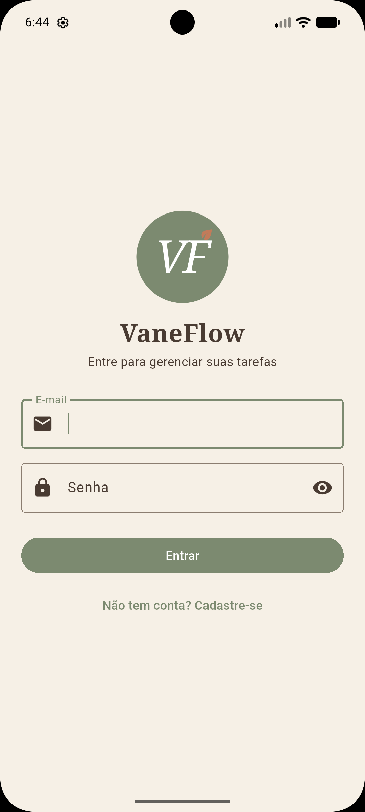
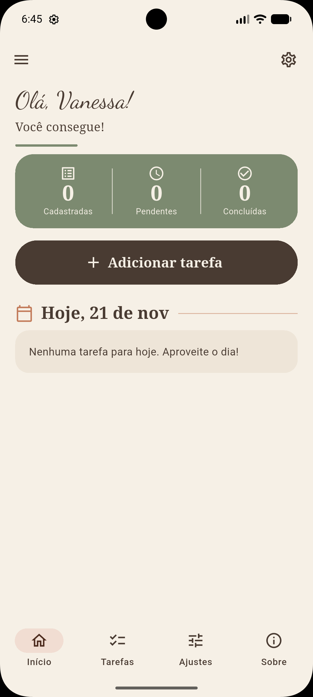
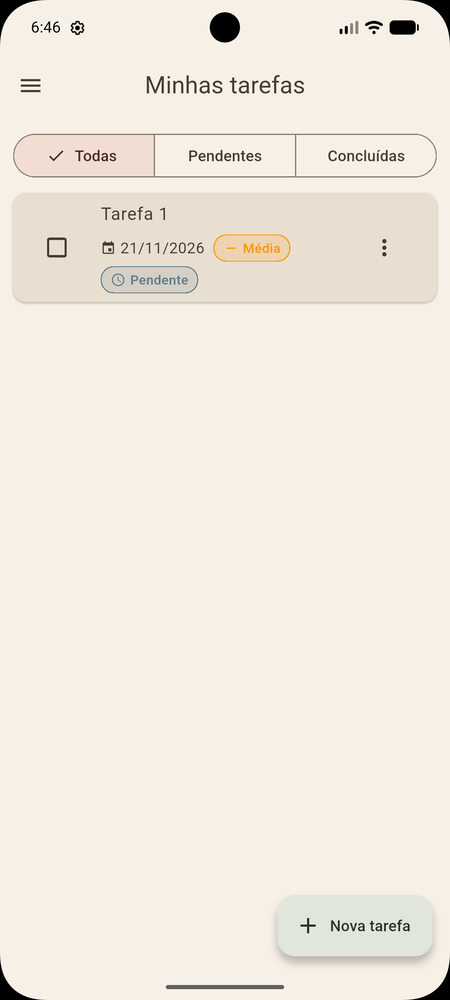
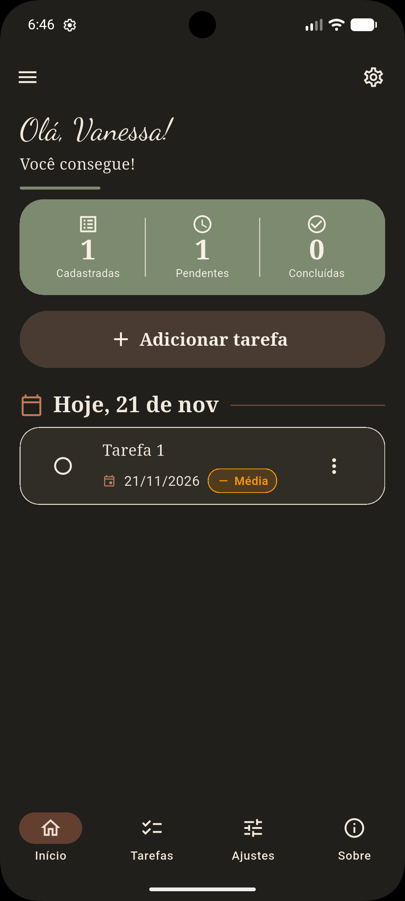

# VaneFlow

Aplicativo mobile de organização de tarefas desenvolvido com Flutter e Firebase como projeto da disciplina de DPROGRAMAÇÃO PARA DISPOSITIVOS MÓVEIS - 6 2026 - 2


O VaneFlow permite criar uma conta, organizar tarefas por data e prioridade, acompanhar o que está pendente ou concluído e escolher entre os temas claro e escuro.

## Funcionalidades

- Cadastro, login e saída de conta com Firebase Authentication (e-mail e senha).
- Sessão do usuário acompanhada pelo Firebase Authentication.
- Cadastro, visualização, edição, conclusão e exclusão de tarefas.
- Tarefas com título, descrição, vencimento, prioridade e situação.
- Tela inicial com resumo e seções para tarefas atrasadas, de hoje e próximas.
- Lista com filtros para todas, pendentes e concluídas.
- Atualização das tarefas em tempo real usando Firebase Realtime Database.
- Tema claro e escuro, com a preferência salva localmente no aparelho.
- Telas de início, tarefas, configurações e informações do aplicativo.

## Capturas de tela

As imagens abaixo ficam em [`docs/capturas`](docs/capturas/).

| Login | Tela inicial |
|---|---|
|  |  |

| Lista de tarefas | Tema escuro |
|---|---|
|  |  |

## Tecnologias

- Flutter e Dart
- Firebase Core
- Firebase Authentication
- Firebase Realtime Database
- SharedPreferences

## Organização do código

```text
lib/
├── main.dart
├── firebase_options.dart
├── models/
│   ├── tarefa.dart
│   └── usuario.dart
├── screens/
│   ├── cadastro_tarefa_screen.dart
│   ├── cadastro_usuario_screen.dart
│   ├── configuracoes_screen.dart
│   ├── detalhes_tarefa_screen.dart
│   ├── home_screen.dart
│   ├── login_screen.dart
│   ├── sobre_screen.dart
│   └── tarefas_screen.dart
├── services/
│   ├── auth_service.dart
│   ├── firebase_service.dart
│   └── preferences_service.dart
├── themes/
│   └── app_theme.dart
├── utils/
│   └── helpers.dart
└── widgets/
    ├── brand_mark.dart
    ├── drawer_menu.dart
    └── prioridade_badge.dart
```

- **`screens`** contém as telas e os formulários.
- **`models`** define os dados de usuário e tarefa.
- **`services`** reúne a autenticação, o acesso ao banco e as preferências locais.
- **`themes`**, **`utils`** e **`widgets`** guardam, respectivamente, os temas, funções auxiliares e componentes reutilizáveis.
- **`main.dart`** inicializa Firebase e preferências, configura os temas e as rotas e direciona a pessoa para a tela adequada conforme a sessão.

## Estrutura dos dados no Firebase

```text
usuarios/{uid}
  nome
  email

tarefas/{uid}/{id}
  titulo
  descricao
  dataVencimento
  prioridade
  concluida
```

As tarefas são separadas pelo identificador (`uid`) do usuário autenticado. O arquivo [`database.rules.json`](database.rules.json) contém regras para permitir leitura e gravação somente quando a conta autenticada corresponde ao `uid` daquele caminho.

## Como executar

### Pré-requisitos

- Flutter e Dart instalados.
- Um dispositivo Android conectado ou um emulador iniciado.
- Acesso ao projeto Firebase configurado para o aplicativo.

### Instalar dependências e iniciar

No terminal, na pasta do projeto, execute:

```bash
flutter pub get
flutter run
```

### Configuração do Firebase

O projeto contém `lib/firebase_options.dart` com as opções usadas durante o desenvolvimento. No Firebase Console, o projeto precisa ter o provedor **E-mail/senha** habilitado em Authentication e um Realtime Database criado. Publique no banco as regras de [`database.rules.json`](database.rules.json).

Para conectar uma cópia do aplicativo a outro projeto Firebase, configure o Firebase CLI e o FlutterFire CLI, execute `flutterfire configure` na pasta do projeto e selecione as plataformas desejadas. Esse processo gera novamente `lib/firebase_options.dart`. Para Android, confira também a configuração Firebase exigida pela plataforma em `android/app/`.

